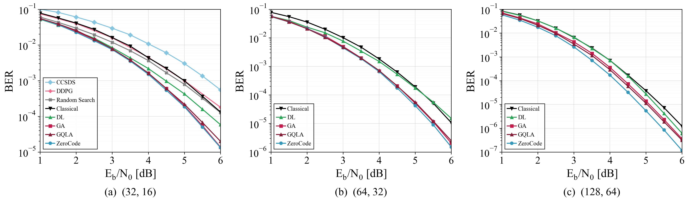
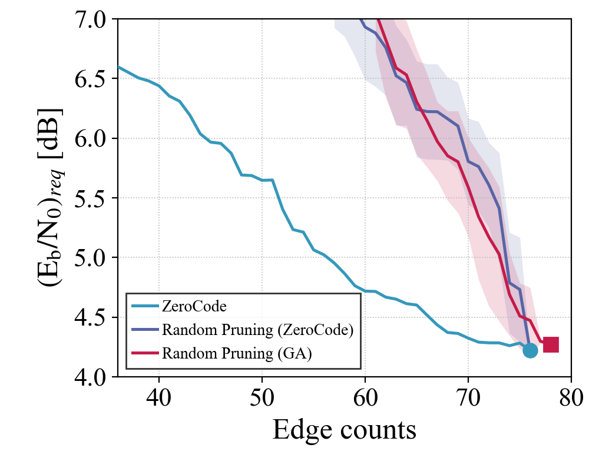
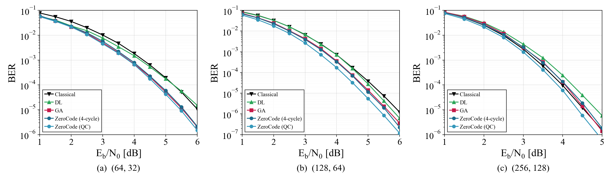
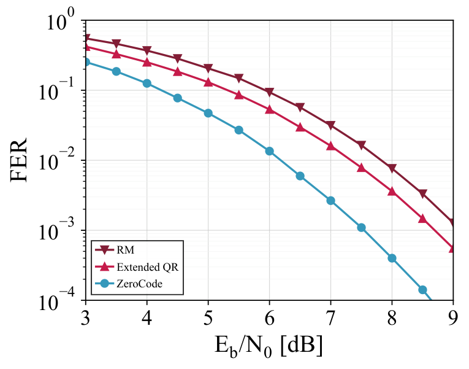

# Supplementary Figures

## Figure 3 — BER comparison including GQLA

BER performance over the AWGN channel for (a) (32,16), (b) (64,32), and (c) (128,64) codes. 

## Figure 6 — Code construction versus random pruning

Comparison of the ZeroCode construction trajectory with random edge pruning from the final ZeroCode and GA parity-check matrices for the (32,16) code. 

## Figure 9 — Comparison of masking strategies

BER comparison between ZeroCode with 4-cycle masking and ZeroCode with QC masking over the AWGN channel for (a) (64,32), (b) (128,64), and (c) (256,128) codes. GA, DL, and classical constructions are included as baselines.

## Figure 10 — Performance with bit-flipping decoding

FER comparison of ZeroCode, Reed–Muller (RM), and extended quadratic-residue (Extended QR) codes of dimensions (32,16) over a binary symmetric channel using hard-decision bit-flipping decoding.

